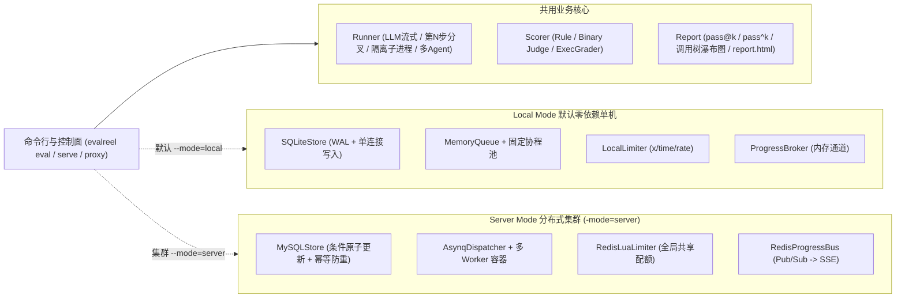

# EvalReel

面向大模型与智能体（Agent）研发的 Go 透明流式代理、混沌故障注入、批量评测与可观测平台。

默认情况下，EvalReel 是一个直接运行的单文件 Go 命令行工具，内置 SQLite 与内存调度器，零外部依赖即可在本地完成轨迹录制、断点分叉横评、隔离子进程评测和离线战报生成；在团队协作或持续集成场景下，可以通过 `-mode=server` 无缝切换为 MySQL 8 + Redis 7 + Asynq 的分布式服务端集群。

---

## 核心特性与演进路线

| 版本 | 状态 | 核心能力 |
| --- | --- | --- |
| **v1.0** | 已完成 | OpenAI 兼容透明流式反向代理（`httputil.ReverseProxy` + `FlushInterval: -1`）、客户端断连级联取消上游请求、SSE 旁路解析（思考与正文双阶段首字延迟、分片 `tool_calls`、真实/估算词元）、`.jsonl.gz` 轨迹落盘、请求侧与流内混沌故障注入（延迟 / 429 / 500 / 断流 / 畸形 JSON），内置可编程 `mockllm` 靶子。 |
| **v2.0** | 已完成 | 单机批量评测引擎（`Store` / `Queue` / `Limiter` 抽象 + 纯 Go SQLite WAL 模式）、固定协程池与指数退避重试、断点续跑（`-resume`）、**第 N 步读档分叉横评**、隔离子进程目录与进程树超时强杀、三合一自动批卷（规则匹配 / 二元 AI 裁判 / Python 单测执行），以及零外部 CDN 依赖的单文件离线 `report.html`（含 `pass@k`、`pass^k` 与单题分歧 Diff）。 |
| **v3.0** | 已完成 | `MySQLStore`（指针型 `Idempotency-Key` 唯一防重 + `longtext` 兼容 + 条件原子收口）、基于 Redis 的 `AsynqDispatcher` 与 `evalreel worker` 多节点消费、Redis Lua 跨节点共享 RPM 限流器、Redis Pub/Sub 跨进程 SSE 进度总线、Docker Compose 多容器集群、结构化 `log/slog` + Prometheus `/metrics` + OpenTelemetry GenAI 链路导出、基于 W3C `traceparent` 的**多 Agent 白盒调用树时间轴瀑布图**。 |
| **v4.0** | 已完成 | MCP（模型上下文协议）透明代理（Stdio 与 Streamable HTTP）、只读工具录制与参数规范化哈希离线 Mock、工具侧 5 类混沌故障注入、单机与集群双模式失败子任务重放、Asynq 死信队列管理、多版本回归趋势对比（`compare.html`）、基于 `go:embed` 的零构建内嵌状态页，以及 GitHub Actions CI。 |

---

## 双模式架构

本地模式与服务端模式共用一套执行器（`runner`）、自动批卷流水线（`scorer`）和战报聚合渲染引擎（`report`），通过存储和调度接口隔离底层依赖：



---

## 快速开始

### 前置条件

- Go `1.27+`
- 本地测试 Python Agent 示例需要 Python `3.12+`（或 `uv`）
- 启动分布式服务端模式需要 Docker 与 Docker Compose

### 方式一：单机零依赖模式（Local Mode）

#### 1. 启动内置模拟大模型服务（可选，用于离线联调或压测）

```bash
go run ./cmd/evalreel mockllm -listen 127.0.0.1:9090 -ttft 300ms -interval 30ms
```

#### 2. 启动透明流式代理录制轨迹与注入故障

```bash
go run ./cmd/evalreel proxy -config ./configs/proxy.example.yaml
# 支持附加 -db ./evalreel.db 将多 Agent trace_spans 同步写入数据库
```

把业务 Agent 的 `OPENAI_BASE_URL` 指向代理监听地址（默认 `http://127.0.0.1:8080/v1`）即可无侵入录制 `.jsonl.gz` 轨迹文件。

#### 3. 命令行跑批评测并生成离线战报

```bash
go run ./cmd/evalreel eval -config ./configs/eval.example.json
# 若中途 Ctrl+C 退出，可通过以下命令跳过已完成题目继续跑完：
go run ./cmd/evalreel eval -resume <run_id>
```

评测完成后会在 `reports/` 目录生成断网双击即可打开的 `report_<run_id>.html`。

#### 4. 启动本地 Gin HTTP 控制面与内嵌状态页

```bash
go run ./cmd/evalreel serve -listen 127.0.0.1:8081
# 启动后浏览器直接访问 http://127.0.0.1:8081/ 查看实时进度与触发对比
```

#### 5. MCP 工具代理、只读 Mock 与失败重跑 / 版本对比（v4.0 单机全内置）

```bash
# HTTP MCP 代理录制磁带（并同步写入 trace_spans 表）
go run ./cmd/evalreel mcp-proxy -transport http -mode record -listen 127.0.0.1:8082 -upstream http://127.0.0.1:9191 -tape ./traces/demo.mcp.jsonl.gz -db ./evalreel.db

# Stdio 严格离线 Mock 回放（完全不启动上游工具子进程）
go run ./cmd/evalreel mcp-proxy -transport stdio -mode mock -mock-fallback strict -tape ./traces/demo.mcp.jsonl.gz

# 一键重跑某场评测里的失败题目（已成功题目跳过不重复计费）
go run ./cmd/evalreel retry -run <run_id>

# 生成多版本回归趋势对比报告 compare.html
go run ./cmd/evalreel compare -runs <run_v1>,<run_v2> -out ./reports/compare.html
```

---

### 方式二：分布式服务端集群（Server Mode）

#### 1. 一键拉起 MySQL 8 + Redis 7 + MockLLM + 1 Server + 2 Worker

```bash
docker compose up -d --build --wait
```

如需一并开启 Prometheus（`9091` 端口）和 Jaeger 链路 UI（`16686` 端口），使用附加配置组启动：

```bash
docker compose --profile observability up -d --build --wait
```

#### 2. 通过接口提交分布式评测任务并查看战报

```bash
curl -X POST http://127.0.0.1:8081/api/runs \
  -H "Content-Type: application/json" \
  -H "Idempotency-Key: ci-build-001" \
  -d '{
    "name": "cluster_smoke",
    "mode": "benchmark",
    "dataset_path": "/app/testdata/toolcall_mini.jsonl",
    "concurrency": 10,
    "trials": 2,
    "max_retries": 2,
    "targets": [
      {
        "name": "mock-cluster",
        "base_url": "http://mockllm:9090/v1",
        "model": "mock-reasoning-v1",
        "rpm_limit": 120
      }
    ],
    "scorers": [{"type": "rule", "name": "has_content", "pattern": "分片"}],
    "output_dir": "/app/reports"
  }'
```

---

## 核心 HTTP 接口

| 方法与路径 | 作用 | 说明 |
| --- | --- | --- |
| `GET /` | 内嵌轻量状态页（`go:embed`） | 零构建单文件页面：看进度、重跑失败、勾选多版本回归对比 |
| `GET /api/health` | 健康检查 | 返回 `{"status":"ok"}` |
| `POST /api/runs` | 创建并异步触发评测 | 支持 `Idempotency-Key` 请求头防重放 |
| `POST /api/runs/:id/retry-failed` | 重跑失败子任务 | 仅重置 `failed` 任务，保留已成功结果（单机与集群均可用） |
| `GET /api/runs` | 查询历史评测列表 | 支持 `limit` 参数，按创建时间倒序 |
| `GET /api/runs/:id` | 查询单场评测详情与子任务 | 返回总任务状态、全部子任务及得分明细 |
| `GET /api/runs/:id/events` | 实时进度推送（SSE） | 本地走内存广播，集群走 Redis Pub/Sub 转发 |
| `GET /api/runs/:id/report` | 获取战报网页 | 返回生成的离线 `report.html` |
| `GET /api/compare` | 多版本回归对比 | 传 `?runs=r1,r2` 返回离线 `compare.html`，加 `format=json` 返回 JSON |
| `GET /api/queues/stats` | 查询队列堆积与死信统计 | 服务端模式返回 `pending`/`active`/`retry`/`archived` |
| `GET /api/queues/archived` | 列出死信队列任务 | 服务端模式下查询 Asynq Archived 失败任务列表 |
| `POST /api/queues/archived/retry` | 重放死信队列任务 | 支持指定 `task_ids` 或 `{"all":true}` |
| `GET /metrics` | Prometheus 监控指标 | 暴露代理请求数、活跃流数、首字延迟、Worker 与限流耗时 |

---

## 实测工程指标与验证数据

以下全部数字来自本地环境实际命令与测试输出记录：

1. **全量单元测试与竞态检测**：开启 `-race` 并连接 MySQL 运行 `go test -race -count=1 ./...`，14 个含测试文件的功能包（`api`、`chaos`、`mcpproxy`、`mockllm`、`observability`、`proxy`、`recorder`、`report`、`runner`、`scheduler`、`scorer`、`sse`、`store`、`worker`）全部通过，并发核心包均开启 `goleak.VerifyTestMain(m)` 检验零协程泄漏。
2. **MySQL 30 万行 `EXPLAIN ANALYZE` 索引验证**（脚本：[mysql_explain_bench.go](file:///e:/vscode/EvalReel/scripts/mysql_explain_bench.go)）：
   - 断点续跑查询（`WHERE run_id = ? AND status IN ('pending', 'running')`）：建立联合索引 `idx_run_status` 后，扫描行数从 `300,000` 行全表扫描（`114.265ms`）降至 `200` 行范围扫描（`12.201ms`）。
   - 战报聚合查询（`WHERE run_id = ? ORDER BY id ASC`）：扫描行数从 `300,000` 行主索引扫描（`115.736ms`）降至 `600` 行索引查找（`23.065ms`）。
3. **双 Worker 50 并发慢流式压测与 `pprof` 分析**（详细报告：[06_v3_benchmark_and_pprof.md](file:///e:/vscode/EvalReel/docs/06_v3_benchmark_and_pprof.md)）：
   - 负载条件：`mockllm` 设置 `500ms` 首字延迟、`100ms` 间隔分 20 块输出（单请求约 `2.6s` 长流）并随机注入 `5%` 的 HTTP 429 报错；并发提交 10 场共 300 条任务（`124ms` 完成入队）。
   - 执行结果：10 场全部正常完成（`FailedTasks=0`），触发 429 的 `14` 条任务经 Asynq 退避重试 100% 恢复，集群总耗时 `20.696s`（有效吞吐 `14.50 tasks/s`）。
   - 资源稳定性：Server 协程数 `Baseline=17 → Peak=45 → 静置 10 秒=25`（`pprof goroutine total 21`，无请求与流式订阅协程残留），`HeapAlloc` 为 `2.58 MB → 8.84 MB → 9.41 MB`。
4. **多 Agent 白盒调用树实测**：通过 [multi_agent.py](file:///e:/vscode/EvalReel/scripts/multi_agent.py)（`planner` → `coder` → `reviewer` 透传 W3C `traceparent` 与 `X-EvalReel-Span-ID`）跑通代理落库 `trace_spans`，离线 `report.html` 正常展开 `调用层级树 (3 跳)` 时间轴瀑布图。

---

## 目录结构与设计文档

```text
EvalReel/
├── cmd/evalreel/             # CLI 入口（mockllm / proxy / mcp-proxy / eval / serve / worker / retry / compare）
├── configs/                  # 代理与评测 JSON/YAML 配置模板
├── deploy/                   # Prometheus 抓取配置
├── docs/                     # 分版本详细设计文档与压测实录
├── internal/
│   ├── api/                  # Gin 控制面接口、幂等防重、SSE 推送与 go:embed 轻量状态页
│   ├── chaos/                # 请求前及流式传输期混沌故障中间件
│   ├── config/               # YAML / JSON 配置解析与校验
│   ├── mcpproxy/             # MCP（Stdio / HTTP）透明代理、只读 Mock 磁带与工具侧故障注入
│   ├── mockllm/              # 支持思考链、分片工具、随机 429 与流故障的模拟服务端
│   ├── model/                # TraceRecord 等核心结构体定义
│   ├── observability/        # log/slog、Prometheus、OTel GenAI 与 W3C traceparent
│   ├── proxy/                # 透明流式反向代理与 Span 持久化
│   ├── recorder/             # 并发安全 .jsonl.gz 异步写入器
│   ├── report/               # 指标聚合、调用树瀑布图、多版本回归对比与离线 HTML 模板
│   ├── runner/               # 纯大模型流式 / 第 N 步分叉 / 隔离子进程 Agent 执行器
│   ├── scheduler/            # 双模式限流器（Local / Redis Lua）、队列、协程池与进度总线
│   ├── scorer/               # 规则匹配 / 二元 AI 裁判 / ExecGrader 判分流水线
│   ├── sse/                  # 抗大块断流的流式旁路解析器
│   ├── store/                # SQLiteStore 与 MySQLStore 状态机及 TraceSpan 存储
│   └── worker/               # Asynq 分布式消费节点处理器
├── scripts/                  # 示例 Agent、多 Agent 演示、EXPLAIN 基准与压测脚本
├── testdata/                 # HumanEval 与工具调用标准极简样本集
├── Dockerfile                # 两阶段编译镜像（运行镜像约 55.8MB）
└── docker-compose.yml        # 多容器集群编排
```

### 设计文档索引

- [01_feasibility_research.md](file:///e:/vscode/EvalReel/docs/01_feasibility_research.md)：竞品调研与可行性分析
- [02_architecture_correction_and_audit.md](file:///e:/vscode/EvalReel/docs/02_architecture_correction_and_audit.md)：物理链路纠偏与三阶段收敛规划
- [03_v1_detailed_design.md](file:///e:/vscode/EvalReel/docs/03_v1_detailed_design.md)：v1.0 透明流式代理与混沌故障注入详细设计
- [04_v2_detailed_design.md](file:///e:/vscode/EvalReel/docs/04_v2_detailed_design.md)：v2.0 单机调度评测引擎与离线战报详细设计
- [05_v3_detailed_design.md](file:///e:/vscode/EvalReel/docs/05_v3_detailed_design.md)：v3.0 分布式服务端、可观测性与多 Agent 调用树设计
- [06_v3_benchmark_and_pprof.md](file:///e:/vscode/EvalReel/docs/06_v3_benchmark_and_pprof.md)：v3.0 MySQL `EXPLAIN` 与分布式压测实录
- [07_v4_detailed_design.md](file:///e:/vscode/EvalReel/docs/07_v4_detailed_design.md)：v4.0 MCP 工具代理、失败重试与多版本回归对比设计
